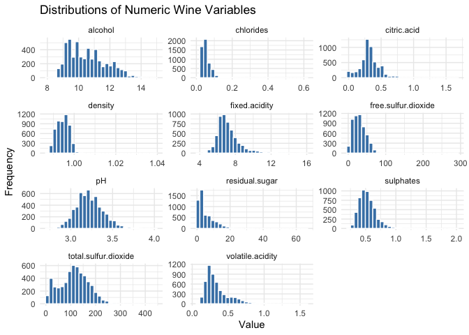
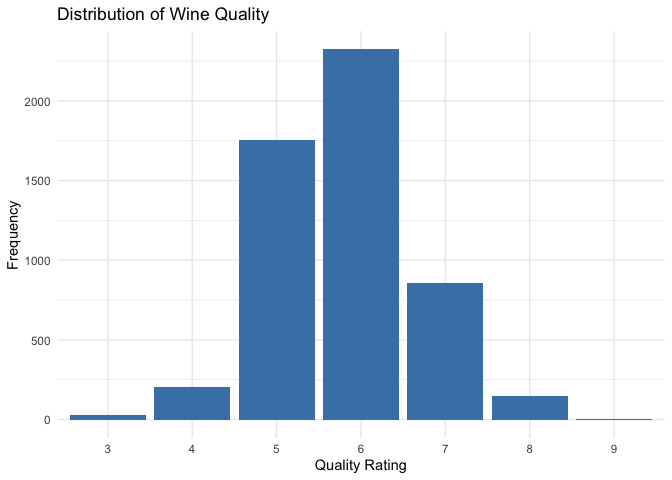
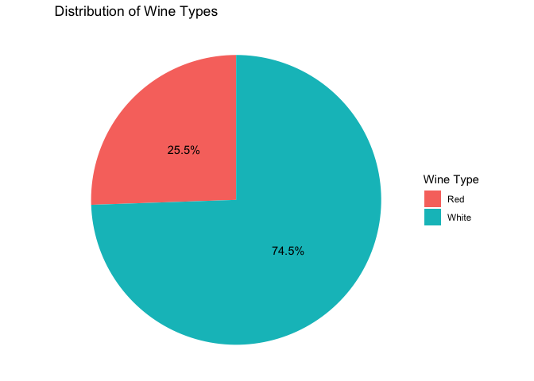
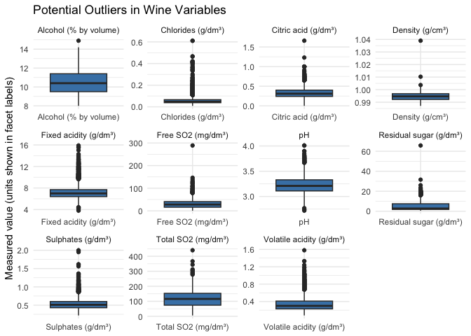
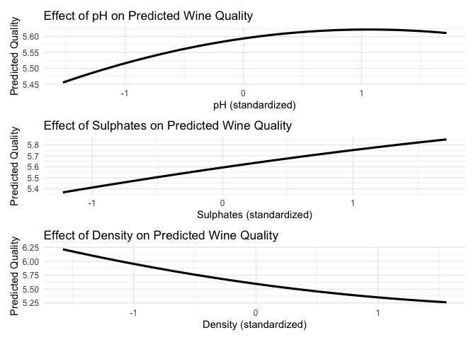

README
================

# EDA with R - Capstone 3

Lilly Zarmehrbakhsh and Abby Nam, DS201

### Business Understanding

Wine quality can be assessed by four factors: balance, length, intensity, and complexity (**BLIC**). These factors are applied after evaluating the wine’s appearance, aroma, and structure, providing a more objective framework than the taster’s individual preference (Brodie, 2021):

- **Balance** is how well the core structure of the wine (e.g., acidity, alcohol, tannins, sweetness, and fruit) harmonize, such that no single component overwhelms the others.

- **Length** is how long the flavor lasts after swallowing.

- **Intensity** is how concentrated and pronounced the flavor is.

- **Complexity** is how many distinct aromas and flavors there are, and how they layer and evolve in the glass.

After assessing a wine on these four factors, a taster can reach a single, justified conclusion about its quality. According to the Wine and Spirit Education Trust (**WSET**) system, the quality of a wine ranges from *poor, acceptable, very good, to outstanding.*

Good to very good wines show balance, decent length, appropriate intensity, and some complexity; outstanding wines excel on all four factors at the same time. On the other hand, poor to acceptable wines fall short on one or more factors, most often length, complexity, or balance (Cysewski, 2026).

### Data Understanding

The datasets were acquired from the UC Irvine Machine Learning Repository, uploaded in 2009: <https://archive.ics.uci.edu/dataset/186/wine+quality>

The two datasets provided were related to red and white variants of Portuguese Vinho Verde wine samples. Many of the attributes include objective tests on the wine samples, such as pH values. The rating of quality is based on the median on at least 3 evaluations made by wine experts. Each expert graded the wine quality between 0 (very bad) and 10 (very excellent).

#### Getting the Dataset

``` r
# import packages
library(tidyverse)
library(ggplot2)

# Import datasets
red <- read.csv2("https://archive.ics.uci.edu/ml/machine-learning-databases/wine-quality/winequality-red.csv") # Use csv2 since columns separated by ; instead of ,
head(red)
```

    ##   fixed.acidity volatile.acidity citric.acid residual.sugar chlorides
    ## 1           7.4              0.7           0            1.9     0.076
    ## 2           7.8             0.88           0            2.6     0.098
    ## 3           7.8             0.76        0.04            2.3     0.092
    ## 4          11.2             0.28        0.56            1.9     0.075
    ## 5           7.4              0.7           0            1.9     0.076
    ## 6           7.4             0.66           0            1.8     0.075
    ##   free.sulfur.dioxide total.sulfur.dioxide density   pH sulphates alcohol
    ## 1                  11                   34  0.9978 3.51      0.56     9.4
    ## 2                  25                   67  0.9968  3.2      0.68     9.8
    ## 3                  15                   54   0.997 3.26      0.65     9.8
    ## 4                  17                   60   0.998 3.16      0.58     9.8
    ## 5                  11                   34  0.9978 3.51      0.56     9.4
    ## 6                  13                   40  0.9978 3.51      0.56     9.4
    ##   quality
    ## 1       5
    ## 2       5
    ## 3       5
    ## 4       6
    ## 5       5
    ## 6       5

``` r
white <- read.csv2("https://archive.ics.uci.edu/ml/machine-learning-databases/wine-quality/winequality-white.csv")
head(white)
```

    ##   fixed.acidity volatile.acidity citric.acid residual.sugar chlorides
    ## 1             7             0.27        0.36           20.7     0.045
    ## 2           6.3              0.3        0.34            1.6     0.049
    ## 3           8.1             0.28         0.4            6.9      0.05
    ## 4           7.2             0.23        0.32            8.5     0.058
    ## 5           7.2             0.23        0.32            8.5     0.058
    ## 6           8.1             0.28         0.4            6.9      0.05
    ##   free.sulfur.dioxide total.sulfur.dioxide density   pH sulphates alcohol
    ## 1                  45                  170   1.001    3      0.45     8.8
    ## 2                  14                  132   0.994  3.3      0.49     9.5
    ## 3                  30                   97  0.9951 3.26      0.44    10.1
    ## 4                  47                  186  0.9956 3.19       0.4     9.9
    ## 5                  47                  186  0.9956 3.19       0.4     9.9
    ## 6                  30                   97  0.9951 3.26      0.44    10.1
    ##   quality
    ## 1       6
    ## 2       6
    ## 3       6
    ## 4       6
    ## 5       6
    ## 6       6

#### Overview of Dataset

**Red Wine:** There are 1599 rows and 12 columns in the red wine dataset.

``` r
glimpse(red)
```

    ## Rows: 1,599
    ## Columns: 12
    ## $ fixed.acidity        <chr> "7.4", "7.8", "7.8", "11.2", "7.4", "7.4", "7.9",…
    ## $ volatile.acidity     <chr> "0.7", "0.88", "0.76", "0.28", "0.7", "0.66", "0.…
    ## $ citric.acid          <chr> "0", "0", "0.04", "0.56", "0", "0", "0.06", "0", …
    ## $ residual.sugar       <chr> "1.9", "2.6", "2.3", "1.9", "1.9", "1.8", "1.6", …
    ## $ chlorides            <chr> "0.076", "0.098", "0.092", "0.075", "0.076", "0.0…
    ## $ free.sulfur.dioxide  <chr> "11", "25", "15", "17", "11", "13", "15", "15", "…
    ## $ total.sulfur.dioxide <chr> "34", "67", "54", "60", "34", "40", "59", "21", "…
    ## $ density              <chr> "0.9978", "0.9968", "0.997", "0.998", "0.9978", "…
    ## $ pH                   <chr> "3.51", "3.2", "3.26", "3.16", "3.51", "3.51", "3…
    ## $ sulphates            <chr> "0.56", "0.68", "0.65", "0.58", "0.56", "0.56", "…
    ## $ alcohol              <chr> "9.4", "9.8", "9.8", "9.8", "9.4", "9.4", "9.4", …
    ## $ quality              <int> 5, 5, 5, 6, 5, 5, 5, 7, 7, 5, 5, 5, 5, 5, 5, 5, 7…

**White Wine:** There are 4898 rows and 12 columns in the white wine dataset.

``` r
glimpse(white)
```

    ## Rows: 4,898
    ## Columns: 12
    ## $ fixed.acidity        <chr> "7", "6.3", "8.1", "7.2", "7.2", "8.1", "6.2", "7…
    ## $ volatile.acidity     <chr> "0.27", "0.3", "0.28", "0.23", "0.23", "0.28", "0…
    ## $ citric.acid          <chr> "0.36", "0.34", "0.4", "0.32", "0.32", "0.4", "0.…
    ## $ residual.sugar       <chr> "20.7", "1.6", "6.9", "8.5", "8.5", "6.9", "7", "…
    ## $ chlorides            <chr> "0.045", "0.049", "0.05", "0.058", "0.058", "0.05…
    ## $ free.sulfur.dioxide  <chr> "45", "14", "30", "47", "47", "30", "30", "45", "…
    ## $ total.sulfur.dioxide <chr> "170", "132", "97", "186", "186", "97", "136", "1…
    ## $ density              <chr> "1.001", "0.994", "0.9951", "0.9956", "0.9956", "…
    ## $ pH                   <chr> "3", "3.3", "3.26", "3.19", "3.19", "3.26", "3.18…
    ## $ sulphates            <chr> "0.45", "0.49", "0.44", "0.4", "0.4", "0.44", "0.…
    ## $ alcohol              <chr> "8.8", "9.5", "10.1", "9.9", "9.9", "10.1", "9.6"…
    ## $ quality              <int> 6, 6, 6, 6, 6, 6, 6, 6, 6, 6, 5, 5, 5, 7, 5, 7, 6…

| **Attribute Name** | **Description** | **Data Type** |
|:---|:---|:--:|
| fixed acidity | The amount of non-volatile acids fixed in the wine; Contribute to its tartness | ratio |
| volatile acidity | The amount of acetic acid in the wine; High levels can lead to an unpleasant vinegar taste | ratio |
| citric acid | The amount of citric acid; Adds freshness and flavor to wines | ratio |
| residual sugar | The amount of sugar remaining after fermentation stops; Measures sweetness | ratio |
| chlorides | The amount of salt/chlorides present in the wine | ratio |
| free sulfur dioxide | The free form of sulfur dioxide ($SO_2$) that exists in equilibrium between molecular $SO_2$ and bisulfite ion, acting as an antimicrobial and antioxidant | ratio |
| total sulfur dioxide | The sum of free and bound forms of sulfur dioxide in the wine | ratio |
| density | The mass per unit volume of the wine; Closely related to alcohol and sugar content | ratio |
| pH | A numeric scale describing how acidic or basic the wine is on a chemical scale | interval |
| sulphates | A wine additive contributing to sulfur dioxide gas levels; acts as an antimicrobial and antioxidant | ratio |
| alcohol | The percent alcohol content by volume in the wine | ratio |
| quality | The quality score assigned to the wine by experts, ranging from 0 (very bad) to 10 (very excellent) | ordinal |

### Data Preparation

For ease of analysis, we merged the red and white wine datasets into one dataframe, adding a new column indicating whether the wine came from the red or white wine dataset.

After combining the red and white wine datasets, the resulting dataset contained 6,497 wine samples and 13 columns. These included 11 physicochemical measurements, the wine-quality rating, and a derived categorical variable identifying wine type (red or white).

``` r
# Identify wine types
red$wine_type <- "Red"
white$wine_type <- "White"

# Combine datasets
wine <- bind_rows(red, white)

# Confirm properly merged
head(wine)
```

    ##   fixed.acidity volatile.acidity citric.acid residual.sugar chlorides
    ## 1           7.4              0.7           0            1.9     0.076
    ## 2           7.8             0.88           0            2.6     0.098
    ## 3           7.8             0.76        0.04            2.3     0.092
    ## 4          11.2             0.28        0.56            1.9     0.075
    ## 5           7.4              0.7           0            1.9     0.076
    ## 6           7.4             0.66           0            1.8     0.075
    ##   free.sulfur.dioxide total.sulfur.dioxide density   pH sulphates alcohol
    ## 1                  11                   34  0.9978 3.51      0.56     9.4
    ## 2                  25                   67  0.9968  3.2      0.68     9.8
    ## 3                  15                   54   0.997 3.26      0.65     9.8
    ## 4                  17                   60   0.998 3.16      0.58     9.8
    ## 5                  11                   34  0.9978 3.51      0.56     9.4
    ## 6                  13                   40  0.9978 3.51      0.56     9.4
    ##   quality wine_type
    ## 1       5       Red
    ## 2       5       Red
    ## 3       5       Red
    ## 4       6       Red
    ## 5       5       Red
    ## 6       5       Red

``` r
table(wine$wine_type)
```

    ## 
    ##   Red White 
    ##  1599  4898

There were no missing values in the dataset. Many of the ratio variables were saved as characters, so we transformed them to numbers:

``` r
# check for NA values
colSums(is.na(wine)) 
```

    ##        fixed.acidity     volatile.acidity          citric.acid 
    ##                    0                    0                    0 
    ##       residual.sugar            chlorides  free.sulfur.dioxide 
    ##                    0                    0                    0 
    ## total.sulfur.dioxide              density                   pH 
    ##                    0                    0                    0 
    ##            sulphates              alcohol              quality 
    ##                    0                    0                    0 
    ##            wine_type 
    ##                    0

``` r
# make numeric variables numeric in R
wine <- wine %>%
  mutate(across(-wine_type, as.numeric))

# Make quality variable ordinal
wine$quality_ord <- factor(wine$quality, ordered = TRUE)
```

Exact duplicate records were removed to prevent identical observations from being counted multiple times in the analysis. However, because the dataset does not provide unique sample identifiers, we do not know whether all identical records represent accidental duplication or simply distinct samples that have identical measured attributes. This data-cleaning decision could then affect the representativeness of the final dataset. Ultimately, we identified 1,177 duplicate wine samples and removed them, resulting in a final data set of 5,320 wine samples.

``` r
library(dplyr)

# 1. Count how many duplicate rows exist
sum(duplicated(wine))
```

    ## [1] 1177

``` r
# 2. View the actual duplicate rows alongside how many times they appear
wine %>%
  group_by(across(everything())) %>%
  filter(n() > 1) %>%
  summarise(count = n(), .groups = "drop") %>%
  arrange(desc(count))
```

    ## # A tibble: 992 × 15
    ##    fixed.acidity volatile.acidity citric.acid residual.sugar chlorides
    ##            <dbl>            <dbl>       <dbl>          <dbl>     <dbl>
    ##  1           7               0.15        0.28           14.7     0.051
    ##  2           7.3             0.19        0.27           13.9     0.057
    ##  3           6.8             0.18        0.3            12.8     0.062
    ##  4           7.4             0.16        0.3            13.7     0.056
    ##  5           7.4             0.16        0.27           15.5     0.05 
    ##  6           7.4             0.19        0.3            12.8     0.053
    ##  7           7.4             0.19        0.31           14.5     0.045
    ##  8           7.6             0.2         0.3            14.2     0.056
    ##  9           5.7             0.22        0.2            16       0.044
    ## 10           6.2             0.23        0.36           17.2     0.039
    ## # ℹ 982 more rows
    ## # ℹ 10 more variables: free.sulfur.dioxide <dbl>, total.sulfur.dioxide <dbl>,
    ## #   density <dbl>, pH <dbl>, sulphates <dbl>, alcohol <dbl>, quality <dbl>,
    ## #   wine_type <chr>, quality_ord <ord>, count <int>

``` r
# 3. Create a clean dataset with duplicates removed
wine_clean <- wine %>% distinct()

summary(wine_clean)
```

    ##  fixed.acidity    volatile.acidity  citric.acid     residual.sugar  
    ##  Min.   : 3.800   Min.   :0.0800   Min.   :0.0000   Min.   : 0.600  
    ##  1st Qu.: 6.400   1st Qu.:0.2300   1st Qu.:0.2400   1st Qu.: 1.800  
    ##  Median : 7.000   Median :0.3000   Median :0.3100   Median : 2.700  
    ##  Mean   : 7.215   Mean   :0.3441   Mean   :0.3185   Mean   : 5.048  
    ##  3rd Qu.: 7.700   3rd Qu.:0.4100   3rd Qu.:0.4000   3rd Qu.: 7.500  
    ##  Max.   :15.900   Max.   :1.5800   Max.   :1.6600   Max.   :65.800  
    ##                                                                     
    ##    chlorides       free.sulfur.dioxide total.sulfur.dioxide    density      
    ##  Min.   :0.00900   Min.   :  1.00      Min.   :  6.0        Min.   :0.9871  
    ##  1st Qu.:0.03800   1st Qu.: 16.00      1st Qu.: 74.0        1st Qu.:0.9922  
    ##  Median :0.04700   Median : 28.00      Median :116.0        Median :0.9947  
    ##  Mean   :0.05669   Mean   : 30.04      Mean   :114.1        Mean   :0.9945  
    ##  3rd Qu.:0.06600   3rd Qu.: 41.00      3rd Qu.:153.2        3rd Qu.:0.9968  
    ##  Max.   :0.61100   Max.   :289.00      Max.   :440.0        Max.   :1.0390  
    ##                                                                             
    ##        pH          sulphates         alcohol         quality     
    ##  Min.   :2.720   Min.   :0.2200   Min.   : 8.00   Min.   :3.000  
    ##  1st Qu.:3.110   1st Qu.:0.4300   1st Qu.: 9.50   1st Qu.:5.000  
    ##  Median :3.210   Median :0.5100   Median :10.40   Median :6.000  
    ##  Mean   :3.225   Mean   :0.5334   Mean   :10.55   Mean   :5.796  
    ##  3rd Qu.:3.330   3rd Qu.:0.6000   3rd Qu.:11.40   3rd Qu.:6.000  
    ##  Max.   :4.010   Max.   :2.0000   Max.   :14.90   Max.   :9.000  
    ##                                                                  
    ##   wine_type         quality_ord
    ##  Length:5320        3:  30     
    ##  Class :character   4: 206     
    ##  Mode  :character   5:1752     
    ##                     6:2323     
    ##                     7: 856     
    ##                     8: 148     
    ##                     9:   5

#### Visualizations

We first looked at the general distribution patterns of each continuous numeric variable using histograms. Variables such as citric acid and pH, visually, appeared to be more normally distributed. Chlorides and residual sugar appeared to have a positively skewed distribution. In particular, the alcohol variable appears to have a large spread of data.

``` r
wine_clean %>%
  dplyr::select(where(is.numeric), -quality) %>%
  tidyr::pivot_longer(
    cols = everything(),
    names_to = "Variable",
    values_to = "Value"
  ) %>%
  dplyr::mutate(
    Variable = dplyr::recode(
      Variable,
      "fixed.acidity" = "Fixed acidity (g/dm³)",
      "volatile.acidity" = "Volatile acidity (g/dm³)",
      "citric.acid" = "Citric acid (g/dm³)",
      "residual.sugar" = "Residual sugar (g/dm³)",
      "chlorides" = "Chlorides (g/dm³)",
      "free.sulfur.dioxide" = "Free SO2 (mg/dm³)",
      "total.sulfur.dioxide" = "Total SO2 (mg/dm³)",
      "density" = "Density (g/cm³)",
      "pH" = "pH",
      "sulphates" = "Sulphates (g/dm³)",
      "alcohol" = "Alcohol (% by volume)"
    )
  ) %>%
  ggplot2::ggplot(
    data = .,
    mapping = ggplot2::aes(x = Value)
  ) +
  ggplot2::geom_histogram(bins = 30, fill = "steelblue", color = "white") +
  ggplot2::facet_wrap(~Variable, scales = "free", ncol = 3) +
  ggplot2::labs(
    title = "Distributions of Numeric Wine Variables",
    x = "Measured value",
    y = "Frequency (number of wines)"
  ) +
  ggplot2::theme_minimal()
```

<!-- -->

Because wine quality was an ordinal variable with discrete categories, we created a bar chart to visualize the distribution. The majority of wines in this dataset received a quality rating between 5 and 7, with ratings of 5 and 6 alone comprising approximately 76.6% of observations. Relatively few wines received ratings at the extremes, with only 30 observations rated 3 and 5 observations rated 9.

``` r
ggplot(wine_clean, aes(x = factor(quality))) +
  geom_bar(fill = "steelblue") +
  labs(
    title = "Distribution of Wine Quality",
    x = "Quality Rating",
    y = "Frequency"
  ) +
  theme_minimal()
```

<!-- -->

The majority of the wines in this dataset are white wines.

``` r
wine_clean %>%
  count(wine_type) %>%
  ggplot(aes(x = "", y = n, fill = wine_type)) +
  geom_col(width = 1) +
  coord_polar("y") +
  geom_text(
    aes(label = paste0(round(n / sum(n) * 100, 1), "%")),
    position = position_stack(vjust = 0.5)
  ) +
  labs(
    title = "Distribution of Wine Types",
    fill = "Wine Type"
  ) +
  theme_void()
```

<!-- -->

To better understand the range and possible outliers in the dataset, we also created boxplots for the continuous numeric variables. These boxplots highlight that the spread of many variables is rather small, even if the distribution as seen in the histogram is somewhat normal (i.e. density). Chlorides, in particular, appears to have the most outliers, suggesting it is heavily positively-skewed.

``` r
wine_clean %>%
  dplyr::select(where(is.numeric), -quality) %>%
  tidyr::pivot_longer(
    everything(),
    names_to = "Variable",
    values_to = "Value"
  ) %>%
  dplyr::mutate(
    Variable = dplyr::recode(
      Variable,
      "fixed.acidity" = "Fixed acidity (g/dm³)",
      "volatile.acidity" = "Volatile acidity (g/dm³)",
      "citric.acid" = "Citric acid (g/dm³)",
      "residual.sugar" = "Residual sugar (g/dm³)",
      "chlorides" = "Chlorides (g/dm³)",
      "free.sulfur.dioxide" = "Free SO2 (mg/dm³)",
      "total.sulfur.dioxide" = "Total SO2 (mg/dm³)",
      "density" = "Density (g/cm³)",
      "pH" = "pH",
      "sulphates" = "Sulphates (g/dm³)",
      "alcohol" = "Alcohol (% by volume)"
    )
  ) %>%
  ggplot2::ggplot(
    aes(x = Variable, y = Value)
  ) +
  geom_boxplot(fill = "steelblue") +
  facet_wrap(~Variable, scales = "free") +
  labs(
    title = "Potential Outliers in Wine Variables",
    x = NULL,
    y = "Measured value (units shown in facet labels)"
  ) +
  theme_minimal()
```

<!-- -->

### Modeling and Evaluating

Our research question was: do pH, sulphates, total sulfur dioxide and density predict wine quality?

We hypothesized that pH, sulphates, total sulfur dioxide and density would all be associated with wine quality. We expected that:

- *pH would be negatively associated with wine quality:* higher pH corresponds with lower acidity and can reduce wine stability and alter sensory characteristics, potentially reducing perceived freshness and balance (Forino et al., 2020), which may warrant lower quality ratings by experts.

- *sulphates would be positively associated with wine quality*: previous research has identified sulphate concentration as a relevant physicochemical predictor of sensory wine quality in Portuguese Vinho Verde wines (Cortez et al., 2009). We expected sulphate concentration to be positively associated with experts’ quality ratings.

- *total sulfur dioxide would be negatively associated with wine quality*: Although sulfur dioxide protects wine against oxidation and microbial spoilage, higher concentrations can influence its sensory characteristics. SO₂ can interact with other wine compounds and influence the aromas perceived by tasters, potentially affecting the balance of desirable aromas and flavors (Coetzee et al., 2018). We therefore hypothesized that higher total sulfur dioxide concentrations would be negatively associated with wine.

- *density would be negatively associated with wine quality*: Alcohol contributes to wine’s body and mouthfeel and has been positively associated with expert quality ratings (Cortez et al., 2009). Because alcohol generally decreases wine density, we expected lower-density wines to be associated with higher quality ratings, although density also reflects other components of wine, including dissolved sugars.

We used a hierarchical ordinal logistic regression to examine whether these four chemical properties that we believed aligned best with how the BLIC factors assessed wine quality, an ordinal outcome variable, above and beyond the type of wine (red vs. white), which was included as a control variable.

``` r
#install.packages('brant')
#install.packages('ordinal') # Install packages to run regression
#install.packages("performance")
library(car)       
library(MASS)      
library(brant)
library(ordinal)
library(performance)

# Make wine_type a standard factor
wine_clean$wine_type <- as.factor(wine_clean$wine_type)           # Converts into a standard factor
wine_clean$quality_ord <- factor(wine_clean$quality,    
                                levels = sort(unique(wine_clean$quality)), 
                                ordered = TRUE)       # Orders outcome

# Standardize density variable to be on a more logical scale
wine_clean$density_scaled <- wine_clean$density * 1000

# Verify ordering
print(levels(wine_clean$quality_ord)) # Note: Data only has values 3-9 for quality
```

    ## [1] "3" "4" "5" "6" "7" "8" "9"

``` r
# Creating the ordinal hierarchical regression model
model_control <- clm(quality_ord ~ wine_type, 
                   data = wine_clean, 
                   link = "logit")

model <- clm(quality_ord ~ wine_type + scale(pH) + scale(sulphates) + 
                     scale(total.sulfur.dioxide) + scale(density), 
                   data = wine_clean, 
                   link = "logit")

# View model summaries
summary(model_control)
```

    ## formula: quality_ord ~ wine_type
    ## data:    wine_clean
    ## 
    ##  link  threshold nobs logLik   AIC      niter max.grad cond.H 
    ##  logit flexible  5320 -6786.54 13587.09 7(0)  5.84e-07 4.2e+02
    ## 
    ## Coefficients:
    ##                Estimate Std. Error z value Pr(>|z|)    
    ## wine_typeWhite  0.50940    0.05842    8.72   <2e-16 ***
    ## ---
    ## Signif. codes:  0 '***' 0.001 '**' 0.01 '*' 0.05 '.' 0.1 ' ' 1
    ## 
    ## Threshold coefficients:
    ##     Estimate Std. Error z value
    ## 3|4 -4.81947    0.18723 -25.741
    ## 4|5 -2.71685    0.07730 -35.145
    ## 5|6 -0.14488    0.05103  -2.839
    ## 6|7  1.84546    0.05770  31.985
    ## 7|8  3.91952    0.09446  41.495
    ## 8|9  7.37060    0.44989  16.383

``` r
summary(model)
```

    ## formula: 
    ## quality_ord ~ wine_type + scale(pH) + scale(sulphates) + scale(total.sulfur.dioxide) + scale(density)
    ## data:    wine_clean
    ## 
    ##  link  threshold nobs logLik   AIC      niter max.grad cond.H 
    ##  logit flexible  5320 -6412.77 12847.55 7(0)  5.48e-07 5.5e+02
    ## 
    ## Coefficients:
    ##                             Estimate Std. Error z value Pr(>|z|)    
    ## wine_typeWhite               0.67936    0.11475   5.920 3.21e-09 ***
    ## scale(pH)                    0.10585    0.02775   3.815 0.000136 ***
    ## scale(sulphates)             0.35430    0.03123  11.346  < 2e-16 ***
    ## scale(total.sulfur.dioxide) -0.19900    0.04211  -4.726 2.29e-06 ***
    ## scale(density)              -0.67316    0.03526 -19.094  < 2e-16 ***
    ## ---
    ## Signif. codes:  0 '***' 0.001 '**' 0.01 '*' 0.05 '.' 0.1 ' ' 1
    ## 
    ## Threshold coefficients:
    ##     Estimate Std. Error z value
    ## 3|4 -4.92979    0.20106 -24.520
    ## 4|5 -2.82463    0.10634 -26.563
    ## 5|6 -0.11062    0.08917  -1.241
    ## 6|7  2.12525    0.09467  22.448
    ## 7|8  4.31143    0.12161  35.452
    ## 8|9  7.78145    0.45640  17.050

``` r
# Get pesudo-R² for both models (Nagelkerke's R²)
r2(model_control)
```

    ##   Nagelkerke's R2: 0.015

``` r
r2(model)
```

    ##   Nagelkerke's R2: 0.155

``` r
# Test if second model significantly improved fit
anova(model_control, model)
```

    ## Likelihood ratio tests of cumulative link models:
    ##  
    ##               formula:                                                                                             
    ## model_control quality_ord ~ wine_type                                                                              
    ## model         quality_ord ~ wine_type + scale(pH) + scale(sulphates) + scale(total.sulfur.dioxide) + scale(density)
    ##               link: threshold:
    ## model_control logit flexible  
    ## model         logit flexible  
    ## 
    ##               no.par   AIC  logLik LR.stat df Pr(>Chisq)    
    ## model_control      7 13587 -6786.5                          
    ## model             11 12848 -6412.8  747.54  4  < 2.2e-16 ***
    ## ---
    ## Signif. codes:  0 '***' 0.001 '**' 0.01 '*' 0.05 '.' 0.1 ' ' 1

Nagelkerke’s R² indicates that the predictor model fits the data better than the control model (Control: R² = .015; Predictor: R² = .155). The likelihood-ratio test found that the predictor model significantly improved fit over the control model, χ²(4) = 747.54, p \< .001.

``` r
# Exponentiating the log-odds and confidence intervals for readability
or_model <- exp(coef(model))
ci_model <- exp(confint(model))

# Extracting predictor rows 
predictors <- names(model$beta)
or_table <- cbind(Odds_Ratio = or_model[predictors], ci_model[predictors, ])
print(round(or_table, 4))
```

    ##                             Odds_Ratio  2.5 % 97.5 %
    ## wine_typeWhite                  1.9726 1.5756 2.4707
    ## scale(pH)                       1.1117 1.0528 1.1738
    ## scale(sulphates)                1.4252 1.3409 1.5155
    ## scale(total.sulfur.dioxide)     0.8195 0.7546 0.8900
    ## scale(density)                  0.5101 0.4759 0.5465

#### Interpreting the Outcome: Wine Quality (3–9)

<table style="width:99%;">
<colgroup>
<col style="width: 20%" />
<col style="width: 6%" />
<col style="width: 5%" />
<col style="width: 67%" />
</colgroup>
<thead>
<tr>
<th style="text-align: left;"><strong>Predictor</strong></th>
<th style="text-align: center;"><strong>Odds Ratio</strong></th>
<th style="text-align: center;"><strong>95% CI</strong></th>
<th style="text-align: left;"><strong>Interpretation</strong></th>
</tr>
</thead>
<tbody>
<tr>
<td style="text-align: left;"><p>White wine (<code>wine_typeWhite</code>)</p>
<p>- Control variable</p></td>
<td style="text-align: center;">1.97</td>
<td style="text-align: center;">[1.58, 2.47]</td>
<td style="text-align: left;">White wine was associated with 1.97 times the cumulative odds of receiving a higher quality rating compared with red wine, holding the other predictors constant.</td>
</tr>
<tr>
<td style="text-align: left;">pH (<code>scale(pH)</code>)</td>
<td style="text-align: center;">1.11</td>
<td style="text-align: center;">[1.05, 1.17]</td>
<td style="text-align: left;">Each +1 SD increase in pH was associated with approximately 11% higher cumulative odds of receiving a higher quality rating, holding the other predictors constant.</td>
</tr>
<tr>
<td style="text-align: left;">Sulphates (<code>scale(sulphates)</code>)</td>
<td style="text-align: center;">1.43</td>
<td style="text-align: center;">[1.34, 1.52]</td>
<td style="text-align: left;">Each +1 SD increase in sulphates was associated with approximately 43% higher cumulative odds of receiving a higher quality rating, holding the other predictors constant.</td>
</tr>
<tr>
<td style="text-align: left;">Total Sulfur Dioxide (<code>scale(total.sulfur.dioxide)</code>)</td>
<td style="text-align: center;">0.82</td>
<td style="text-align: center;">[0.76, 0.89]</td>
<td style="text-align: left;">Each +1 SD increase in total sulfur dioxide was associated with approximately 18% lower cumulative odds of receiving a higher quality rating, holding the other predictors constant.</td>
</tr>
<tr>
<td style="text-align: left;">Density (<code>scale(density)</code>)</td>
<td style="text-align: center;">0.51</td>
<td style="text-align: center;">[0.48, 0.55]</td>
<td style="text-align: left;">Each <strong>+1 SD</strong> increase in density was associated with approximately 49% lower cumulative odds of receiving a higher quality rating, holding the other predictors constant.</td>
</tr>
</tbody>
</table>

*Note:* The odds ratios represent changes in the cumulative odds of receiving a higher wine-quality rating. For example, a 1 SD increase in pH is associated with approximately 11% higher cumulative odds of receiving a rating above a given quality threshold, holding the other predictors constant. This does not mean that the probability of receiving a specific rating, such as a 7 instead of a 6, increases by 11%.

These interpretations are based on the proportional-odds assumption, which assumes that predictor effects are consistent across quality thresholds. However, subsequent tests indicated that this assumption was not fully satisfied for several predictors. Therefore, the odds-ratio interpretations should be considered with this limitation in mind.

#### Assumption Checks

The model assumes that each wine observation represents an independent sample. Because the dataset does not identify a repeated-measures or clustering structure among the observations, independence was treated as a reasonable modeling assumption. However, this assumption cannot be directly verified from the available data.

Multicollinearity was assessed using variance inflation factors (VIF). All predictors had VIF values below 5, indicating that multicollinearity was not a significant concern. Based on the nominal effects test, several predictors did not meet the assumption of proportional odds, indicating that the effect of wine type, sulphates, total sulfur dioxide and density is not consistent across the different thresholds of wine quality.

``` r
#multicollinearity for multiple regression
vif_model <- lm(quality ~ wine_type + pH + sulphates + total.sulfur.dioxide + density_scaled, data = wine_clean) 
vif(vif_model)
```

    ##            wine_type                   pH            sulphates 
    ##             3.601298             1.125609             1.334880 
    ## total.sulfur.dioxide       density_scaled 
    ##             2.491669             1.601052

``` r
# proportional odds
nominal_test(model)
```

    ## Tests of nominal effects
    ## 
    ## formula: quality_ord ~ wine_type + scale(pH) + scale(sulphates) + scale(total.sulfur.dioxide) + scale(density)
    ##                             Df  logLik   AIC    LRT  Pr(>Chi)    
    ## <none>                         -6412.8 12848                     
    ## wine_type                    5 -6404.2 12840 17.132  0.004257 ** 
    ## scale(pH)                    5 -6407.5 12847 10.634  0.059141 .  
    ## scale(sulphates)             5 -6406.3 12845 12.952  0.023831 *  
    ## scale(total.sulfur.dioxide)  5 -6396.6 12825 32.258 5.283e-06 ***
    ## scale(density)               5 -6368.1 12768 89.339 < 2.2e-16 ***
    ## ---
    ## Signif. codes:  0 '***' 0.001 '**' 0.01 '*' 0.05 '.' 0.1 ' ' 1

The linearity-in-the-logit assumption did not hold for several of our predictors when adding quadratic terms individually to the original model. Holm correction was used for the likelihood-ratio tests to account for multiple hypothesis testing and control the family-wise error rate.

ANOVA comparisons showed that adding quadratic terms for pH, sulphates, and density significantly improved model fit, even after applying a Holm correction for multiple comparisons. In contrast, adding a quadratic term for total sulfur dioxide did not significantly improve model fit. These findings suggest that the relationships between pH, sulphates, and density and wine quality may be nonlinear, supporting the inclusion of their quadratic terms in the final model.

``` r
# linearity in the logit: Whether each continuous predictor has an approximately linear relationship with the cumulative log-odds of wine quality

# pH 
model_pH_quad <- clm(
  quality_ord ~ wine_type + scale(pH) +
    I(scale(pH)^2) +
    scale(total.sulfur.dioxide) +
    scale(sulphates) +
    scale(density),
  data = wine_clean,
  link = "logit"
)

# sulphates 
model_sulph_quad <- clm(
  quality_ord ~ wine_type + scale(sulphates) +
    I(scale(sulphates)^2) +
    scale(pH) +
    scale(total.sulfur.dioxide) +
    scale(density),
  data = wine_clean,
  link = "logit"
)

# sulfur dioxide
model_sulphdio_quad <- clm(
  quality_ord ~ wine_type + scale(total.sulfur.dioxide) +
    I(scale(total.sulfur.dioxide)^2) +
    scale(pH) +
    scale(sulphates) +
    scale(density),
  data = wine_clean,
  link = "logit"
)

# density
model_density_quad <- clm(
  quality_ord ~ wine_type + scale(density) +
    I(scale(density)^2) +
    scale(pH) +
    scale(sulphates) +
    scale(total.sulfur.dioxide),
  data = wine_clean,
  link = "logit"
)

anova(model, model_pH_quad)
```

    ## Likelihood ratio tests of cumulative link models:
    ##  
    ##               formula:                                                                                                              
    ## model         quality_ord ~ wine_type + scale(pH) + scale(sulphates) + scale(total.sulfur.dioxide) + scale(density)                 
    ## model_pH_quad quality_ord ~ wine_type + scale(pH) + I(scale(pH)^2) + scale(total.sulfur.dioxide) + scale(sulphates) + scale(density)
    ##               link: threshold:
    ## model         logit flexible  
    ## model_pH_quad logit flexible  
    ## 
    ##               no.par   AIC  logLik LR.stat df Pr(>Chisq)    
    ## model             11 12848 -6412.8                          
    ## model_pH_quad     12 12836 -6406.0  13.464  1  0.0002431 ***
    ## ---
    ## Signif. codes:  0 '***' 0.001 '**' 0.01 '*' 0.05 '.' 0.1 ' ' 1

``` r
anova(model, model_sulph_quad)
```

    ## Likelihood ratio tests of cumulative link models:
    ##  
    ##                  formula:                                                                                                                     
    ## model            quality_ord ~ wine_type + scale(pH) + scale(sulphates) + scale(total.sulfur.dioxide) + scale(density)                        
    ## model_sulph_quad quality_ord ~ wine_type + scale(sulphates) + I(scale(sulphates)^2) + scale(pH) + scale(total.sulfur.dioxide) + scale(density)
    ##                  link: threshold:
    ## model            logit flexible  
    ## model_sulph_quad logit flexible  
    ## 
    ##                  no.par   AIC  logLik LR.stat df Pr(>Chisq)   
    ## model                11 12848 -6412.8                         
    ## model_sulph_quad     12 12839 -6407.6  10.269  1   0.001353 **
    ## ---
    ## Signif. codes:  0 '***' 0.001 '**' 0.01 '*' 0.05 '.' 0.1 ' ' 1

``` r
anova(model, model_sulphdio_quad)
```

    ## Likelihood ratio tests of cumulative link models:
    ##  
    ##                     formula:                                                                                                                                
    ## model               quality_ord ~ wine_type + scale(pH) + scale(sulphates) + scale(total.sulfur.dioxide) + scale(density)                                   
    ## model_sulphdio_quad quality_ord ~ wine_type + scale(total.sulfur.dioxide) + I(scale(total.sulfur.dioxide)^2) + scale(pH) + scale(sulphates) + scale(density)
    ##                     link: threshold:
    ## model               logit flexible  
    ## model_sulphdio_quad logit flexible  
    ## 
    ##                     no.par   AIC  logLik LR.stat df Pr(>Chisq)  
    ## model                   11 12848 -6412.8                        
    ## model_sulphdio_quad     12 12847 -6411.3  2.9174  1    0.08763 .
    ## ---
    ## Signif. codes:  0 '***' 0.001 '**' 0.01 '*' 0.05 '.' 0.1 ' ' 1

``` r
anova(model, model_density_quad)
```

    ## Likelihood ratio tests of cumulative link models:
    ##  
    ##                    formula:                                                                                                                   
    ## model              quality_ord ~ wine_type + scale(pH) + scale(sulphates) + scale(total.sulfur.dioxide) + scale(density)                      
    ## model_density_quad quality_ord ~ wine_type + scale(density) + I(scale(density)^2) + scale(pH) + scale(sulphates) + scale(total.sulfur.dioxide)
    ##                    link: threshold:
    ## model              logit flexible  
    ## model_density_quad logit flexible  
    ## 
    ##                    no.par   AIC  logLik LR.stat df Pr(>Chisq)    
    ## model                  11 12848 -6412.8                          
    ## model_density_quad     12 12778 -6376.9  71.768  1  < 2.2e-16 ***
    ## ---
    ## Signif. codes:  0 '***' 0.001 '**' 0.01 '*' 0.05 '.' 0.1 ' ' 1

``` r
# Extract p-values from the four model comparisons
quadratic_p <- c(
  pH = anova(model, model_pH_quad)[2, "Pr(>Chisq)"],
  sulphates = anova(model, model_sulph_quad)[2, "Pr(>Chisq)"],
  total_sulfur_dioxide = anova(model, model_sulphdio_quad)[2, "Pr(>Chisq)"],
  density = anova(model, model_density_quad)[2, "Pr(>Chisq)"]
)

# Apply Holm correction
quadratic_adjusted <- p.adjust(
  quadratic_p,
  method = "holm"
)

# Compare original and adjusted p-values
data.frame(
  Predictor = names(quadratic_p),
  Original_p = quadratic_p,
  Adjusted_p = quadratic_adjusted
)
```

    ##                                 Predictor   Original_p   Adjusted_p
    ## pH                                     pH 2.431387e-04 7.294162e-04
    ## sulphates                       sulphates 1.352750e-03 2.705501e-03
    ## total_sulfur_dioxide total_sulfur_dioxide 8.762740e-02 8.762740e-02
    ## density                           density 2.420044e-17 9.680178e-17

Wines rated quality 5 and 6 comprised approximately 76.6% of the data set, while quality 3 wines only had 30 observations, and quality 9 wines had only 5 observations. This could also pose an issue because compared to the “normal” quality wines, the model has relatively little information to estimate the lower and upper bounds for wine quality.

``` r
quality_counts <- as.data.frame(table(wine_clean$quality_ord))
colnames(quality_counts) <- c("Quality", "Frequency")

quality_counts$Percentage <-
  round(quality_counts$Frequency / sum(quality_counts$Frequency) * 100, 2)

quality_counts
```

    ##   Quality Frequency Percentage
    ## 1       3        30       0.56
    ## 2       4       206       3.87
    ## 3       5      1752      32.93
    ## 4       6      2323      43.67
    ## 5       7       856      16.09
    ## 6       8       148       2.78
    ## 7       9         5       0.09

We tested the original model’s convergence to assess the numerical stability of the ordinal logistic regression estimates. The model converged successfully (convergence = 0), and its maximum gradient was approximately 5.48 × 10⁻7, extremely close to 0, indicating that the model’s optimization has stabilized.

``` r
model$convergence
```

    ## $code
    ## [1] 0
    ## 
    ## $messages
    ## [1] "successful convergence"
    ## 
    ## $alg.message
    ## [1] "Absolute and relative convergence criteria were met"

``` r
model$maxGradient
```

    ## [1] 5.482926e-07

#### Quadratic Ordinal Logistic Regression

The quadratic model, which controlled for wine type, showed a significant improvement in fit compared to the original hierarchical ordinal logistic regression model (χ²(3) = 94.98, p \< .001). Nagelkerke’s pseudo-R² increased from 0.155 to 0.172, suggesting an improvement in the model’s explanatory power.

Wine type, pH, sulphates, total sulfur dioxide, and density were all statistically significant predictors of wine quality, controlling for the other variables in the model. The quadratic terms for pH (β = −0.061, p \< .001), sulphates (β = −0.033, p = .001), and density (β = 0.130, p \< .001) were also statistically significant, suggesting nonlinear relationships between these predictors and wine quality. In contrast, the quadratic term for total sulfur dioxide was not retained because it did not significantly improve model fit after applying a Holm correction for multiple comparisons.

Although the quadratic model improved overall model fit, the proportional-odds assumption was not fully satisfied. Tests of nominal effects indicated potential violations for wine type, pH, pH², sulphates, total sulfur dioxide, density, and density². The quadratic term for sulphates did not show a statistically significant violation. These results suggest that the effects of several predictors may vary across different thresholds of wine quality. A partial proportional-odds model could potentially address these violations by allowing selected predictor effects to vary across thresholds.

``` r
# Standardize predictors
wine_clean$pH_z <- as.numeric(scale(wine_clean$pH))
wine_clean$sulphates_z <- as.numeric(scale(wine_clean$sulphates))
wine_clean$tsd_z <- as.numeric(scale(wine_clean$total.sulfur.dioxide))
wine_clean$density_z <- as.numeric(scale(wine_clean$density))

# Fit final quadratic model
model_quad <- clm(
  quality_ord ~ wine_type +
    pH_z + I(pH_z^2) +
    sulphates_z + I(sulphates_z^2) +
    tsd_z +
    density_z + I(density_z^2),
  data = wine_clean,
  link = "logit"
)

summary(model_quad)
```

    ## formula: 
    ## quality_ord ~ wine_type + pH_z + I(pH_z^2) + sulphates_z + I(sulphates_z^2) + tsd_z + density_z + I(density_z^2)
    ## data:    wine_clean
    ## 
    ##  link  threshold nobs logLik   AIC      niter max.grad cond.H 
    ##  logit flexible  5320 -6365.29 12758.57 7(0)  5.55e-07 3.7e+03
    ## 
    ## Coefficients:
    ##                  Estimate Std. Error z value Pr(>|z|)    
    ## wine_typeWhite    0.60679    0.11514   5.270 1.36e-07 ***
    ## pH_z              0.12807    0.02921   4.384 1.17e-05 ***
    ## I(pH_z^2)        -0.06053    0.01727  -3.505 0.000456 ***
    ## sulphates_z       0.41480    0.03687  11.250  < 2e-16 ***
    ## I(sulphates_z^2) -0.03344    0.01020  -3.279 0.001041 ** 
    ## tsd_z            -0.17125    0.04227  -4.051 5.10e-05 ***
    ## density_z        -0.72733    0.03533 -20.589  < 2e-16 ***
    ## I(density_z^2)    0.12974    0.02288   5.671 1.42e-08 ***
    ## ---
    ## Signif. codes:  0 '***' 0.001 '**' 0.01 '*' 0.05 '.' 0.1 ' ' 1
    ## 
    ## Threshold coefficients:
    ##     Estimate Std. Error z value
    ## 3|4 -4.96499    0.20239 -24.532
    ## 4|5 -2.85753    0.10872 -26.282
    ## 5|6 -0.14398    0.09158  -1.572
    ## 6|7  2.13134    0.09759  21.839
    ## 7|8  4.34992    0.12490  34.827
    ## 8|9  7.82632    0.45736  17.112

``` r
# Compare against original linear model
anova(model, model_quad)
```

    ## Likelihood ratio tests of cumulative link models:
    ##  
    ##            formula:                                                                                                        
    ## model      quality_ord ~ wine_type + scale(pH) + scale(sulphates) + scale(total.sulfur.dioxide) + scale(density)           
    ## model_quad quality_ord ~ wine_type + pH_z + I(pH_z^2) + sulphates_z + I(sulphates_z^2) + tsd_z + density_z + I(density_z^2)
    ##            link: threshold:
    ## model      logit flexible  
    ## model_quad logit flexible  
    ## 
    ##            no.par   AIC  logLik LR.stat df Pr(>Chisq)    
    ## model          11 12848 -6412.8                          
    ## model_quad     14 12759 -6365.3  94.975  3  < 2.2e-16 ***
    ## ---
    ## Signif. codes:  0 '***' 0.001 '**' 0.01 '*' 0.05 '.' 0.1 ' ' 1

``` r
# Compare AIC and pseudo-R-squared
AIC(model, model_quad)
```

    ##            df      AIC
    ## model      11 12847.55
    ## model_quad 14 12758.57

``` r
r2(model)
```

    ##   Nagelkerke's R2: 0.155

``` r
r2(model_quad)
```

    ##   Nagelkerke's R2: 0.172

``` r
# Check convergence
model_quad$convergence
```

    ## $code
    ## [1] 0
    ## 
    ## $messages
    ## [1] "successful convergence"
    ## 
    ## $alg.message
    ## [1] "Absolute and relative convergence criteria were met"

``` r
model_quad$maxGradient
```

    ## [1] 5.547496e-07

``` r
# Check proportional odds
nominal_test(model_quad)
```

    ## Tests of nominal effects
    ## 
    ## formula: quality_ord ~ wine_type + pH_z + I(pH_z^2) + sulphates_z + I(sulphates_z^2) + tsd_z + density_z + I(density_z^2)
    ##                  Df  logLik   AIC    LRT  Pr(>Chi)    
    ## <none>              -6365.3 12759                     
    ## wine_type         5 -6356.3 12751 17.916  0.003054 ** 
    ## pH_z              5 -6359.3 12757 11.908  0.036069 *  
    ## I(pH_z^2)         5 -6356.1 12750 18.473  0.002409 ** 
    ## sulphates_z       5 -6359.1 12756 12.434  0.029304 *  
    ## I(sulphates_z^2)  5 -6361.4 12761  7.794  0.167954    
    ## tsd_z             5 -6349.1 12736 32.391 4.971e-06 ***
    ## density_z         5 -6328.4 12695 73.721 1.720e-14 ***
    ## I(density_z^2)    5 -6339.8 12718 50.987 8.703e-10 ***
    ## ---
    ## Signif. codes:  0 '***' 0.001 '**' 0.01 '*' 0.05 '.' 0.1 ' ' 1

These plots show predicted expected wine quality while holding the other standardized predictors at their means and wine type constant at Red. pH demonstrated a positive relationship with predicted quality that weakened at higher pH levels. Sulphates also demonstrated a positive relationship with predicted quality, although the association became less pronounced at higher concentrations. In contrast, density demonstrated a negative relationship with predicted quality, with the rate of decline becoming smaller at higher density levels. Finally, total sulfur dioxide demonstrated a negative linear relationship with predicted wine quality.

``` r
# Visualize nonlinear relationships of standardized predictors with wine quality

plot_quadratic <- function(predictor, label) {
  
  x_values <- seq(
    quantile(wine_clean[[predictor]], 0.05, na.rm = TRUE),
    quantile(wine_clean[[predictor]], 0.95, na.rm = TRUE),
    length.out = 100
  )
  
  newdata <- data.frame(
    wine_type = factor(
      levels(wine_clean$wine_type)[1],
      levels = levels(wine_clean$wine_type)
    ),
    pH_z = 0,
    sulphates_z = 0,
    tsd_z = 0,
    density_z = 0
  )
  
  newdata <- newdata[rep(1, length(x_values)), ]
  
  newdata[[predictor]] <- x_values
  
  probabilities <- predict(
    model_quad,
    newdata = newdata,
    type = "prob"
  )
  
  if (is.list(probabilities)) {
    probabilities <- probabilities$fit
  }
  
  quality_values <- as.numeric(levels(wine_clean$quality_ord))
  
  expected_quality <- as.numeric(
    probabilities %*% quality_values
  )
  
  plot_data <- data.frame(
    predictor = x_values,
    quality = expected_quality
  )
  
  ggplot(plot_data, aes(x = predictor, y = quality)) +
    geom_line(linewidth = 1.1) +
    labs(
      title = paste("Effect of", label, "on Predicted Wine Quality"),
      x = paste(label, "(standardized)"),
      y = "Predicted Expected Quality Rating"
    ) +
    theme_minimal()
}

library(patchwork)

p1 <- plot_quadratic("pH_z", "pH") +
  labs(y = "Predicted Quality")

p2 <- plot_quadratic("sulphates_z", "Sulphates") +
  labs(y = "Predicted Quality")

p3 <- plot_quadratic("density_z", "Density") +
  labs(y = "Predicted Quality")

(p1 / p2 / p3) &
  theme(
    plot.title = element_text(size = 13),
    axis.title = element_text(size = 11),
    axis.text = element_text(size = 9)
  )
```

<!-- -->

### Partial proportional-odds models

Nominal effects tests for the quadratic model indicated potential violations involving wine type, pH, sulphates, total sulfur dioxide, and density. To investigate these violations, we fitted a series of partial proportional odds models, allowing selected predictors to vary across the different wine quality thresholds.

First, relaxing the proportional-odds assumption for total sulfur dioxide and density significantly improved model fit compared with the original quadratic model (LR = 105.64, *p* \< .001; AIC = 12,672.93 vs. 12,759). Allowing the quadratic density term to also vary across thresholds further improved fit (LR = 40.43, *p* \< .001; AIC = 12,642.50). Allowing the quadratic pH term to vary across thresholds resulted in an additional improvement (LR = 13.84, *p* = .017; AIC = 12,638.66).

We also explored an additional model that allowed wine type to vary across thresholds. However, this model failed to converge and was therefore excluded from further consideration. The final nominal effects test indicated that wine type continued to violate the proportional odds assumption (LR = 28.84, *p* \< .001). No significant evidence of violations was found for linear pH (*p* = .317) or either the linear or quadratic sulphates terms (*p* = .174 and *p* = .087). Therefore, although the final partial proportional-odds model accommodated several departures from the proportional-odds assumption identified in the initial quadratic model, the remaining violation for wine type should be acknowledged when interpreting the results.

``` r
# Initial partial proportional-odds model
model_ppo <- clm(
  quality_ord ~ wine_type + pH_z + I(pH_z^2) +
    sulphates_z + I(sulphates_z^2) +
    tsd_z + density_z + I(density_z^2),
  nominal = ~ tsd_z + density_z,
  data = wine_clean,
  link = "logit"
)

# Additional relaxation of quadratic density
model_ppo_dens2 <- clm(
  quality_ord ~ wine_type + pH_z + I(pH_z^2) +
    sulphates_z + I(sulphates_z^2) +
    tsd_z + density_z + I(density_z^2),
  nominal = ~ tsd_z + density_z + I(density_z^2),
  data = wine_clean,
  link = "logit"
)

# Additional relaxation of quadratic pH
model_ppo_ph <- clm(
  quality_ord ~ wine_type + pH_z + I(pH_z^2) +
    sulphates_z + I(sulphates_z^2) +
    tsd_z + density_z + I(density_z^2),
  nominal = ~ tsd_z + density_z + I(density_z^2) +
    I(pH_z^2),
  data = wine_clean,
  link = "logit"
)

# Attempt to relax wine type (did not converge)
model_ppo_wine <- clm(
  quality_ord ~ wine_type + pH_z + I(pH_z^2) +
    sulphates_z + I(sulphates_z^2) +
    tsd_z + density_z + I(density_z^2),
  nominal = ~ tsd_z + density_z + I(density_z^2) +
    wine_type,
  data = wine_clean,
  link = "logit"
)

summary(model_ppo)
```

    ## formula: 
    ## quality_ord ~ wine_type + pH_z + I(pH_z^2) + sulphates_z + I(sulphates_z^2) + tsd_z + density_z + I(density_z^2)
    ## nominal: ~tsd_z + density_z
    ## data:    wine_clean
    ## 
    ##  link  threshold nobs logLik   AIC      niter max.grad cond.H 
    ##  logit flexible  5320 -6312.47 12672.93 8(0)  1.29e-10 1.5e+04
    ## 
    ## Coefficients: (2 not defined because of singularities)
    ##                  Estimate Std. Error z value Pr(>|z|)    
    ## wine_typeWhite    0.62098    0.11613   5.347 8.94e-08 ***
    ## pH_z              0.12977    0.02937   4.419 9.93e-06 ***
    ## I(pH_z^2)        -0.06042    0.01720  -3.514 0.000442 ***
    ## sulphates_z       0.41130    0.03700  11.118  < 2e-16 ***
    ## I(sulphates_z^2) -0.03245    0.01044  -3.109 0.001880 ** 
    ## tsd_z                  NA         NA      NA       NA    
    ## density_z              NA         NA      NA       NA    
    ## I(density_z^2)    0.09044    0.02474   3.655 0.000257 ***
    ## ---
    ## Signif. codes:  0 '***' 0.001 '**' 0.01 '*' 0.05 '.' 0.1 ' ' 1
    ## 
    ## Threshold coefficients:
    ##                 Estimate Std. Error z value
    ## 3|4.(Intercept) -4.87936    0.22149 -22.029
    ## 4|5.(Intercept) -2.68304    0.10973 -24.452
    ## 5|6.(Intercept) -0.14118    0.09263  -1.524
    ## 6|7.(Intercept)  2.16992    0.09931  21.850
    ## 7|8.(Intercept)  4.41442    0.14323  30.820
    ## 8|9.(Intercept)  8.18514    0.78580  10.416
    ## 3|4.tsd_z        0.11481    0.16444   0.698
    ## 4|5.tsd_z       -0.08909    0.07330  -1.215
    ## 5|6.tsd_z        0.17317    0.04455   3.887
    ## 6|7.tsd_z        0.30442    0.05435   5.601
    ## 7|8.tsd_z        0.10490    0.11538   0.909
    ## 8|9.tsd_z       -0.01799    0.71587  -0.025
    ## 3|4.density_z    0.46044    0.22541   2.043
    ## 4|5.density_z    0.11708    0.07816   1.498
    ## 5|6.density_z    0.70945    0.04023  17.636
    ## 6|7.density_z    0.83139    0.04603  18.061
    ## 7|8.density_z    0.87334    0.09578   9.119
    ## 8|9.density_z    1.18096    0.61768   1.912

``` r
summary(model_ppo_dens2)
```

    ## formula: 
    ## quality_ord ~ wine_type + pH_z + I(pH_z^2) + sulphates_z + I(sulphates_z^2) + tsd_z + density_z + I(density_z^2)
    ## nominal: ~tsd_z + density_z + I(density_z^2)
    ## data:    wine_clean
    ## 
    ##  link  threshold nobs logLik   AIC      niter max.grad cond.H 
    ##  logit flexible  5320 -6292.25 12642.50 9(2)  1.88e-08 1.1e+04
    ## 
    ## Coefficients: (3 not defined because of singularities)
    ##                  Estimate Std. Error z value Pr(>|z|)    
    ## wine_typeWhite    0.58303    0.11607   5.023 5.08e-07 ***
    ## pH_z              0.14195    0.02934   4.838 1.31e-06 ***
    ## I(pH_z^2)        -0.06293    0.01718  -3.664 0.000249 ***
    ## sulphates_z       0.40262    0.03706  10.865  < 2e-16 ***
    ## I(sulphates_z^2) -0.03179    0.01044  -3.045 0.002329 ** 
    ## tsd_z                  NA         NA      NA       NA    
    ## density_z              NA         NA      NA       NA    
    ## I(density_z^2)         NA         NA      NA       NA    
    ## ---
    ## Signif. codes:  0 '***' 0.001 '**' 0.01 '*' 0.05 '.' 0.1 ' ' 1
    ## 
    ## Threshold coefficients:
    ##                     Estimate Std. Error z value
    ## 3|4.(Intercept)    -4.962377   0.258856 -19.170
    ## 4|5.(Intercept)    -2.619577   0.118159 -22.170
    ## 5|6.(Intercept)    -0.055408   0.092448  -0.599
    ## 6|7.(Intercept)     2.115452   0.097863  21.616
    ## 7|8.(Intercept)     4.291975   0.155290  27.638
    ## 8|9.(Intercept)     8.276629   0.780504  10.604
    ## 3|4.tsd_z           0.104150   0.166300   0.626
    ## 4|5.tsd_z          -0.102107   0.073635  -1.387
    ## 5|6.tsd_z           0.157206   0.044548   3.529
    ## 6|7.tsd_z           0.298254   0.054148   5.508
    ## 7|8.tsd_z           0.107326   0.116114   0.924
    ## 8|9.tsd_z          -0.020480   0.695222  -0.029
    ## 3|4.density_z       0.384154   0.230128   1.669
    ## 4|5.density_z       0.187165   0.080333   2.330
    ## 5|6.density_z       0.768606   0.042846  17.939
    ## 6|7.density_z       0.868458   0.045797  18.963
    ## 7|8.density_z       0.985524   0.124790   7.897
    ## 8|9.density_z       0.981765   0.548108   1.791
    ## 3|4.I(density_z^2) -0.014530   0.175614  -0.083
    ## 4|5.I(density_z^2) -0.227333   0.064241  -3.539
    ## 5|6.I(density_z^2) -0.245219   0.030942  -7.925
    ## 6|7.I(density_z^2) -0.061995   0.009089  -6.821
    ## 7|8.I(density_z^2)  0.032719   0.084132   0.389
    ## 8|9.I(density_z^2) -0.273600   0.349930  -0.782

``` r
summary(model_ppo_ph)
```

    ## formula: 
    ## quality_ord ~ wine_type + pH_z + I(pH_z^2) + sulphates_z + I(sulphates_z^2) + tsd_z + density_z + I(density_z^2)
    ## nominal: ~tsd_z + density_z + I(density_z^2) + I(pH_z^2)
    ## data:    wine_clean
    ## 
    ##  link  threshold nobs logLik   AIC      niter max.grad cond.H 
    ##  logit flexible  5320 -6285.33 12638.66 10(2) 4.50e-10 1.4e+04
    ## 
    ## Coefficients: (4 not defined because of singularities)
    ##                  Estimate Std. Error z value Pr(>|z|)    
    ## wine_typeWhite    0.58463    0.11619   5.032 4.86e-07 ***
    ## pH_z              0.14132    0.02919   4.842 1.29e-06 ***
    ## I(pH_z^2)              NA         NA      NA       NA    
    ## sulphates_z       0.40209    0.03700  10.868  < 2e-16 ***
    ## I(sulphates_z^2) -0.03115    0.01019  -3.055  0.00225 ** 
    ## tsd_z                  NA         NA      NA       NA    
    ## density_z              NA         NA      NA       NA    
    ## I(density_z^2)         NA         NA      NA       NA    
    ## ---
    ## Signif. codes:  0 '***' 0.001 '**' 0.01 '*' 0.05 '.' 0.1 ' ' 1
    ## 
    ## Threshold coefficients:
    ##                     Estimate Std. Error z value
    ## 3|4.(Intercept)    -5.173252   0.284333 -18.194
    ## 4|5.(Intercept)    -2.758794   0.126521 -21.805
    ## 5|6.(Intercept)    -0.038665   0.092926  -0.416
    ## 6|7.(Intercept)     2.120563   0.099527  21.306
    ## 7|8.(Intercept)     4.307639   0.168045  25.634
    ## 8|9.(Intercept)     7.975294   0.830841   9.599
    ## 3|4.tsd_z           0.140155   0.165181   0.848
    ## 4|5.tsd_z          -0.075326   0.073805  -1.021
    ## 5|6.tsd_z           0.155321   0.044604   3.482
    ## 6|7.tsd_z           0.298234   0.054184   5.504
    ## 7|8.tsd_z           0.107897   0.116152   0.929
    ## 8|9.tsd_z           0.018504   0.678391   0.027
    ## 3|4.density_z       0.377331   0.232991   1.620
    ## 4|5.density_z       0.189821   0.080486   2.358
    ## 5|6.density_z       0.768443   0.042834  17.940
    ## 6|7.density_z       0.868431   0.045798  18.962
    ## 7|8.density_z       0.985734   0.124786   7.899
    ## 8|9.density_z       1.038313   0.548252   1.894
    ## 3|4.I(density_z^2)  0.000341   0.176770   0.002
    ## 4|5.I(density_z^2) -0.211571   0.065636  -3.223
    ## 5|6.I(density_z^2) -0.246265   0.030947  -7.958
    ## 6|7.I(density_z^2) -0.061994   0.009090  -6.820
    ## 7|8.I(density_z^2)  0.031551   0.084382   0.374
    ## 8|9.I(density_z^2) -0.257204   0.345675  -0.744
    ## 3|4.I(pH_z^2)       0.213135   0.070900   3.006
    ## 4|5.I(pH_z^2)       0.168729   0.032577   5.179
    ## 5|6.I(pH_z^2)       0.048694   0.019146   2.543
    ## 6|7.I(pH_z^2)       0.059540   0.024000   2.481
    ## 7|8.I(pH_z^2)       0.050301   0.057770   0.871
    ## 8|9.I(pH_z^2)       0.554102   0.624031   0.888

``` r
summary(model_ppo_wine)
```

    ## formula: 
    ## quality_ord ~ wine_type + pH_z + I(pH_z^2) + sulphates_z + I(sulphates_z^2) + tsd_z + density_z + I(density_z^2)
    ## nominal: ~tsd_z + density_z + I(density_z^2) + wine_type
    ## data:    wine_clean
    ## 
    ##  link  threshold nobs logLik   AIC      niter max.grad cond.H 
    ##  logit flexible  5320 -6277.45 12622.90 23(2) 3.82e-09 1.3e+13
    ## 
    ## Coefficients: (4 not defined because of singularities)
    ##                  Estimate Std. Error z value Pr(>|z|)
    ## wine_typeWhite         NA         NA      NA       NA
    ## pH_z              0.14082         NA      NA       NA
    ## I(pH_z^2)        -0.06283         NA      NA       NA
    ## sulphates_z       0.40399         NA      NA       NA
    ## I(sulphates_z^2) -0.03157         NA      NA       NA
    ## tsd_z                  NA         NA      NA       NA
    ## density_z              NA         NA      NA       NA
    ## I(density_z^2)         NA         NA      NA       NA
    ## 
    ## Threshold coefficients:
    ##                     Estimate Std. Error z value
    ## 3|4.(Intercept)     -4.61787         NA      NA
    ## 4|5.(Intercept)     -3.36336         NA      NA
    ## 5|6.(Intercept)      0.07547         NA      NA
    ## 6|7.(Intercept)      1.99615         NA      NA
    ## 7|8.(Intercept)      4.28781         NA      NA
    ## 8|9.(Intercept)     27.79811         NA      NA
    ## 3|4.tsd_z            0.24302         NA      NA
    ## 4|5.tsd_z           -0.38853         NA      NA
    ## 5|6.tsd_z            0.21307         NA      NA
    ## 6|7.tsd_z            0.24556         NA      NA
    ## 7|8.tsd_z            0.09591         NA      NA
    ## 8|9.tsd_z            0.48685         NA      NA
    ## 3|4.density_z        0.28486         NA      NA
    ## 4|5.density_z        0.44955         NA      NA
    ## 5|6.density_z        0.73096         NA      NA
    ## 6|7.density_z        0.90029         NA      NA
    ## 7|8.density_z        0.99059         NA      NA
    ## 8|9.density_z        0.77855         NA      NA
    ## 3|4.I(density_z^2)   0.01298         NA      NA
    ## 4|5.I(density_z^2)  -0.24730         NA      NA
    ## 5|6.I(density_z^2)  -0.24124         NA      NA
    ## 6|7.I(density_z^2)  -0.06405         NA      NA
    ## 7|8.I(density_z^2)   0.03162         NA      NA
    ## 8|9.I(density_z^2)  -0.27396         NA      NA
    ## 3|4.wine_typeWhite  -1.09642         NA      NA
    ## 4|5.wine_typeWhite   0.37613         NA      NA
    ## 5|6.wine_typeWhite  -0.76292         NA      NA
    ## 6|7.wine_typeWhite  -0.41922         NA      NA
    ## 7|8.wine_typeWhite  -0.57263         NA      NA
    ## 8|9.wine_typeWhite -20.43814         NA      NA

``` r
model_ppo$convergence
```

    ## $code
    ## [1] 0
    ## 
    ## $messages
    ## [1] "successful convergence"
    ## 
    ## $alg.message
    ## [1] "Absolute and relative convergence criteria were met"

``` r
model_ppo_dens2$convergence
```

    ## $code
    ## [1] 0
    ## 
    ## $messages
    ## [1] "successful convergence"
    ## 
    ## $alg.message
    ## [1] "Absolute and relative convergence criteria were met"

``` r
model_ppo_ph$convergence
```

    ## $code
    ## [1] 0
    ## 
    ## $messages
    ## [1] "successful convergence"
    ## 
    ## $alg.message
    ## [1] "Absolute and relative convergence criteria were met"

``` r
model_ppo_wine$convergence
```

    ## $code
    ## [1] 1
    ## 
    ## $messages
    ## [1] "Hessian is numerically singular: parameters are not uniquely determined"
    ## 
    ## $alg.message
    ## [1] "Absolute convergence criterion was met, but relative criterion was not met"

``` r
AIC(model_ppo)
```

    ## [1] 12672.93

``` r
AIC(model_ppo_dens2)
```

    ## [1] 12642.5

``` r
AIC(model_ppo_ph)
```

    ## [1] 12638.66

``` r
anova(model_quad, model_ppo)
```

    ## Likelihood ratio tests of cumulative link models:
    ##  
    ##            formula:                                                                                                        
    ## model_quad quality_ord ~ wine_type + pH_z + I(pH_z^2) + sulphates_z + I(sulphates_z^2) + tsd_z + density_z + I(density_z^2)
    ## model_ppo  quality_ord ~ wine_type + pH_z + I(pH_z^2) + sulphates_z + I(sulphates_z^2) + tsd_z + density_z + I(density_z^2)
    ##            nominal:           link: threshold:
    ## model_quad ~1                 logit flexible  
    ## model_ppo  ~tsd_z + density_z logit flexible  
    ## 
    ##            no.par   AIC  logLik LR.stat df Pr(>Chisq)    
    ## model_quad     14 12759 -6365.3                          
    ## model_ppo      24 12673 -6312.5  105.64 10  < 2.2e-16 ***
    ## ---
    ## Signif. codes:  0 '***' 0.001 '**' 0.01 '*' 0.05 '.' 0.1 ' ' 1

``` r
anova(model_ppo, model_ppo_dens2)
```

    ## Likelihood ratio tests of cumulative link models:
    ##  
    ##                 formula:                                                                                                        
    ## model_ppo       quality_ord ~ wine_type + pH_z + I(pH_z^2) + sulphates_z + I(sulphates_z^2) + tsd_z + density_z + I(density_z^2)
    ## model_ppo_dens2 quality_ord ~ wine_type + pH_z + I(pH_z^2) + sulphates_z + I(sulphates_z^2) + tsd_z + density_z + I(density_z^2)
    ##                 nominal:                            link: threshold:
    ## model_ppo       ~tsd_z + density_z                  logit flexible  
    ## model_ppo_dens2 ~tsd_z + density_z + I(density_z^2) logit flexible  
    ## 
    ##                 no.par   AIC  logLik LR.stat df Pr(>Chisq)    
    ## model_ppo           24 12673 -6312.5                          
    ## model_ppo_dens2     29 12643 -6292.3   40.43  5  1.223e-07 ***
    ## ---
    ## Signif. codes:  0 '***' 0.001 '**' 0.01 '*' 0.05 '.' 0.1 ' ' 1

``` r
anova(model_ppo_dens2, model_ppo_ph)
```

    ## Likelihood ratio tests of cumulative link models:
    ##  
    ##                 formula:                                                                                                        
    ## model_ppo_dens2 quality_ord ~ wine_type + pH_z + I(pH_z^2) + sulphates_z + I(sulphates_z^2) + tsd_z + density_z + I(density_z^2)
    ## model_ppo_ph    quality_ord ~ wine_type + pH_z + I(pH_z^2) + sulphates_z + I(sulphates_z^2) + tsd_z + density_z + I(density_z^2)
    ##                 nominal:                                        link:
    ## model_ppo_dens2 ~tsd_z + density_z + I(density_z^2)             logit
    ## model_ppo_ph    ~tsd_z + density_z + I(density_z^2) + I(pH_z^2) logit
    ##                 threshold:
    ## model_ppo_dens2 flexible  
    ## model_ppo_ph    flexible  
    ## 
    ##                 no.par   AIC  logLik LR.stat df Pr(>Chisq)  
    ## model_ppo_dens2     29 12643 -6292.3                        
    ## model_ppo_ph        34 12639 -6285.3  13.843  5    0.01664 *
    ## ---
    ## Signif. codes:  0 '***' 0.001 '**' 0.01 '*' 0.05 '.' 0.1 ' ' 1

``` r
nominal_test(model_ppo_ph)
```

    ## Tests of nominal effects
    ## 
    ## formula: quality_ord ~ wine_type + pH_z + I(pH_z^2) + sulphates_z + I(sulphates_z^2) + tsd_z + density_z + I(density_z^2)
    ## nominal: ~tsd_z + density_z + I(density_z^2) + I(pH_z^2)
    ##                  Df  logLik   AIC     LRT  Pr(>Chi)    
    ## <none>              -6285.3 12639                      
    ## wine_type         5 -6270.9 12620 28.8380 2.495e-05 ***
    ## pH_z              5 -6282.4 12643  5.8876    0.3173    
    ## sulphates_z       5 -6281.5 12641  7.6924    0.1740    
    ## I(sulphates_z^2)  5 -6280.5 12639  9.6090    0.0871 .  
    ## ---
    ## Signif. codes:  0 '***' 0.001 '**' 0.01 '*' 0.05 '.' 0.1 ' ' 1

The partial proportional-odds analysis also affected the interpretation of several predictors. Although the original quadratic proportional-odds model suggested negative associations between wine quality and total sulfur dioxide and density, the final partial proportional-odds model produced predominantly positive threshold-specific estimates for total sulfur dioxide and positive linear estimates for density. Thus, these relationships were not consistent with the original model’s estimated directions. In contrast, the positive linear association between pH and wine quality and the positive linear and negative quadratic associations for sulphates were retained in the final model. These comparisons suggest that violations of the proportional-odds assumption were particularly relevant to interpreting the relationships involving total sulfur dioxide and density.

``` r
model_comparison <- data.frame(
  Model = c(
    "Initial quadratic PO",
    "Partial PO 1",
    "Partial PO 2",
    "Partial PO 3 (final)",
    "Partial PO 4"
  ),
  `Threshold-specific effects` = c(
    "None",
    "TSD + density",
    "TSD + density + density²",
    "TSD + density + density² + pH²",
    "TSD + density + density² + pH² + wine type"
  ),
  AIC = c(
    AIC(model_quad),
    AIC(model_ppo),
    AIC(model_ppo_dens2),
    AIC(model_ppo_ph),
    NA
  ),
  `Likelihood-ratio test` = c(
    "—",
    "LR = 105.64, p < .001",
    "LR = 40.43, p < .001",
    "LR = 13.84, p = .017",
    "Not interpreted"
  ),
  Convergence = c(
    model_quad$convergence$code,
    model_ppo$convergence$code,
    model_ppo_dens2$convergence$code,
    model_ppo_ph$convergence$code,
    model_ppo_wine$convergence$code
  )
)

model_comparison$Convergence <- ifelse(
  model_comparison$Convergence == 0,
  "Yes",
  "No"
)

knitr::kable(
  model_comparison,
  digits = 2,
  caption = "Comparison of proportional-odds and partial proportional-odds models",
  col.names = c(
    "Model",
    "Threshold-specific effects",
    "AIC",
    "Likelihood-ratio test",
    "Converged?"
  )
)
```

| Model | Threshold-specific effects | AIC | Likelihood-ratio test | Converged? |
|:---|:---|---:|:---|:---|
| Initial quadratic PO | None | 12758.57 | — | Yes |
| Partial PO 1 | TSD + density | 12672.93 | LR = 105.64, p \< .001 | Yes |
| Partial PO 2 | TSD + density + density² | 12642.50 | LR = 40.43, p \< .001 | Yes |
| Partial PO 3 (final) | TSD + density + density² + pH² | 12638.66 | LR = 13.84, p = .017 | Yes |
| Partial PO 4 | TSD + density + density² + pH² + wine type | NA | Not interpreted | No |

Comparison of proportional-odds and partial proportional-odds models

### Conclusions

The hypothesis that pH would be negatively associated with wine quality was not supported. The linear pH term demonstrated a positive association with wine quality. Although the initial quadratic proportional odds model suggested that this positive association weakened at higher pH levels, the partial proportional odds analysis indicated that the quadratic pH effect varied across quality thresholds. Similarly, the hypotheses that total sulfur dioxide and density would be negatively associated with wine quality were not consistently supported by the final model. Their estimated effects varied across quality thresholds, with positive linear estimates for density and predominantly positive estimates for total sulfur dioxide. In contrast, the hypothesis that sulphates would be positively associated with wine quality was supported. Sulphates demonstrated a positive linear association and a negative quadratic association, suggesting that the positive relationship became less pronounced at higher sulphate levels.

Overall, our analysis suggests that several physicochemical characteristics are associated with wine quality, even after controlling for wine type. However, the relationships between these characteristics and wine quality were not necessarily consistent across quality thresholds. The final partial proportional odds model allowed the effects of the quadratic pH term, total sulfur dioxide, and both density terms to vary across quality thresholds, highlighting the complexity of the relationships between chemical properties and wine quality. These findings suggest that evaluating multiple physicochemical characteristics together may be important when assessing wine quality. Nevertheless, these associations do not establish that directly manipulating any individual chemical property will independently improve wine quality, as other characteristics and interactions may also contribute to the final rating.

Additionally, this dataset focused exclusively on red and white Vinho Verde wines, with quality scores ranging from 3 to 9. The distribution of quality ratings was concentrated around scores of 5 and 6, with relatively few observations at the extremes. Other wine varieties and styles may demonstrate different relationships between the same physicochemical properties and wine quality. Therefore, these findings should not be overgeneralized to wines outside the scope of this dataset. Finally, the final partial proportional-odds model continued to show evidence of a proportional-odds violation for wine type, which should be considered when interpreting the results.

### **References**

Brodie, L. (2021, March 31). *The BLIC test: A simple way to tell how good your wine is*. Bacchus & Brodie. <https://www.bacchusandbrodie.com/blog/the-blic-test-a-simple-way-to-tell-how-good-your-wine-is>

Coetzee, C., Buica, A., & du Toit, W. J. (2018). Research note: The use of SO2 to bind acetaldehyde in wine: Sensory implications. *South African Journal of Enology & Viticulture*, *32*(2). <https://doi.org/10.21548/39-2-3156>

Cortez, P., Cerdeira, A., Almeida, F., Matos, T., & Reis, J. (2009). Modeling wine preferences by data mining from physicochemical properties. *Decision Support Systems*, *47*(4), 547–553. <https://doi.org/10.1016/j.dss.2009.05.016>

Cysewski, S. (2026). *BLIC*. Wine with Seth. <https://www.winewithseth.com/winewiki/blic/>

Forino, M., Picariello, L., Rinaldi, A., Moio, L., & Gambuti, A. (2020). How must pH affects the level of red wine phenols. *LWT*, *129*, Article 109546. <https://doi.org/10.1016/j.lwt.2020.109546>
